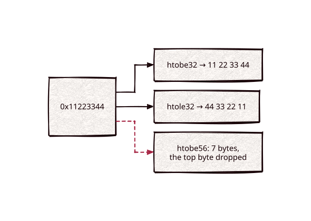

# endian

[](https://github.com/Kronuz/endian/actions/workflows/ci.yml)
[](LICENSE)


Byte-order conversion that reads the same on every platform, in C++20:
`htobe32`, `le64toh`, and friends from one header on Linux, macOS, FreeBSD, and
Windows, plus 56-bit variants the system headers lack. For wire formats and
on-disk layouts.



## ✨ Highlights

- **One spelling everywhere**: maps `<endian.h>`, `<machine/endian.h>`,
  `<sys/endian.h>`, and the MSVC intrinsics onto one set of names.
- **The full set**: `bswap16/32/64`, `htobe*`/`be*toh`, `htole*`/`le*toh`.
- **56-bit variants** (`htobe56`, `be56toh`, …) for 7-byte ids.
- **Free at runtime**: macros that fold to one intrinsic, or to nothing.

## 📦 Installation

Requires a C++20 compiler; CMake 3.14 or newer for the CMake route. CI builds it
on Linux (x86_64, arm64), macOS (arm64, x86_64), and FreeBSD, plus ASan, UBSan,
and TSan builds.

```cmake
include(FetchContent)
FetchContent_Declare(endian
  GIT_REPOSITORY https://github.com/Kronuz/endian.git
  GIT_TAG        main)
FetchContent_MakeAvailable(endian)

target_link_libraries(my_app PRIVATE endian::endian)
```

Or copy `endian.hh` onto your include path.

## 🚀 Quick start

```cpp
#include "endian.hh"

#include <cassert>
#include <cstdint>

int main() {
	uint32_t wire = htobe32(0x11223344);       // bytes 11 22 33 44 in memory
	assert(be32toh(wire) == 0x11223344);

	uint64_t id = 0xFF123456789ABCDEULL;       // only the low 7 bytes count
	assert(be56toh(htobe56(id)) == 0x00123456789ABCDEULL);
}
```

## 🎯 When to use it

- ✅ Serializing integers in a fixed byte order across platforms.
- ❌ C++23 code that only needs swaps: `std::byteswap` covers 16, 32, and 64 bits.

## 📚 Documentation

- [ARCHITECTURE.md](ARCHITECTURE.md): how each platform is mapped.
- [AGENTS.md](AGENTS.md): repository map and traps.

## 🛠️ Building and testing

```sh
cmake -B build && cmake --build build && ctest --test-dir build
```

## 🤝 Contributing

Issues and pull requests are welcome. Read [AGENTS.md](AGENTS.md) first. CI must
pass on every platform.

## 📄 License

MIT, Copyright (c) 2015-2018 Dubalu LLC. See [LICENSE](LICENSE). Extracted from
[Xapiand](https://github.com/Kronuz/Xapiand).
